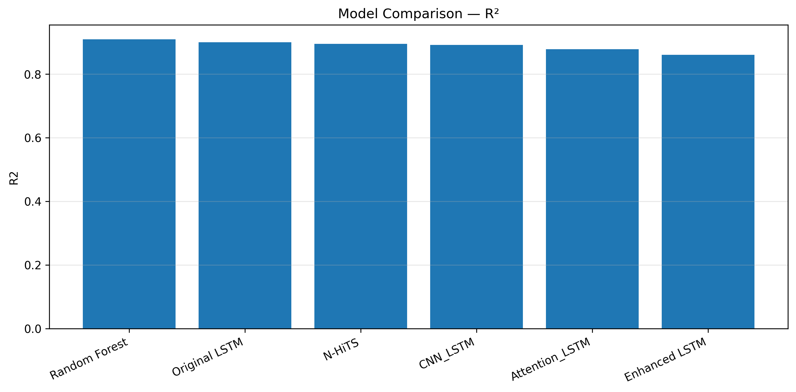
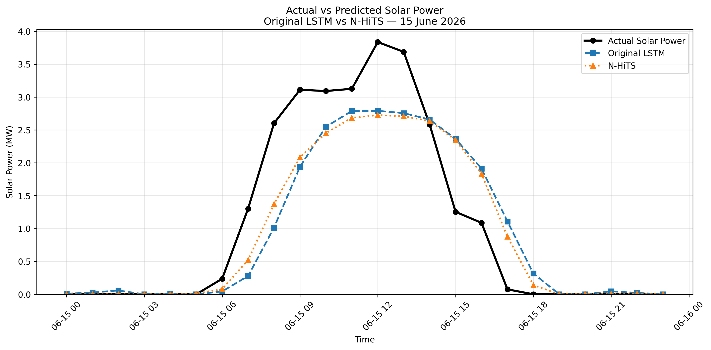
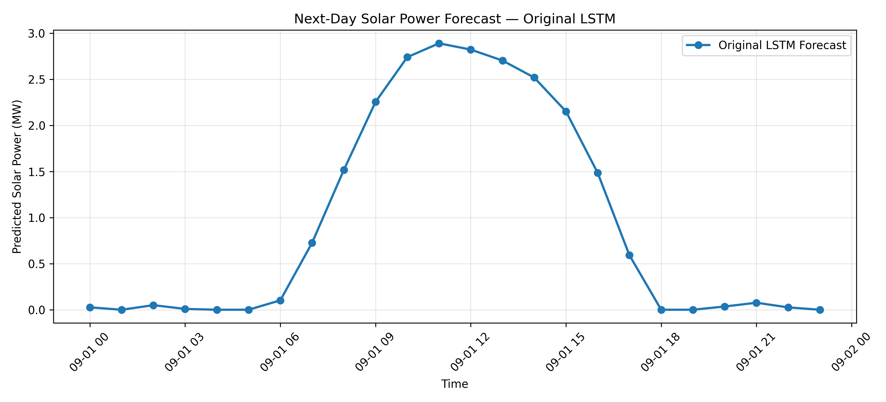

<div align="center">

# ☀️ LUCIS
### Solar PV Power Forecasting Using Machine Learning & Deep Learning

**Day-ahead forecasting of solar power generation using historical plant data**


</div>

---

## 📌 Overview

**LUCIS** is a solar photovoltaic (PV) power forecasting project that compares **six machine learning and deep learning approaches** for predicting the next 24 hours of electricity generation from the previous 168 hours (seven days) of plant output.

The project covers data preprocessing, chronological train/validation/test splits, model training, evaluation, visual comparison, and a next-day forecasting demonstration.

## 🎯 Objectives

- Forecast **24 hourly power values** using **168 hours of historical generation**.
- Compare traditional machine learning and deep learning forecasting methods.
- Evaluate performance using **MAE, RMSE, and R²**.
- Visualize predictions and model performance.
- Demonstrate a next-day forecast using a trained LSTM.

## 📊 Dataset

The study uses historical generation records from a **5 MW solar PV plant in Telangana, India**.

| Attribute | Description |
| :--- | :--- |
| Plant capacity | 5 MW |
| Location | Telangana, India |
| Historical coverage | March 2019 – August 2026 |
| Original sampling interval | 15 minutes |
| Processed sampling interval | 1 hour |
| Hourly timeline | 65,736 timestamps |
| Observed hourly values | 64,989 |
| Missing hourly values | 747 |
| Model input window | Previous 168 hours |
| Forecast horizon | Next 24 hours |

**Data handling:** Missing measurements are not automatically treated as zero generation. The data is split chronologically to avoid training on future observations.

**Public repository note:** The original dataset, processed datasets, and certain large model artifacts are excluded from this repository. Redistribution rights for the source data should be verified before publishing it.

## 🔄 Forecasting Workflow

```text
15-minute solar PV generation records
                  |
                  v
       Data cleaning and validation
                  |
                  v
       Hourly time-series preparation
                  |
                  v
       Chronological dataset split
                  |
                  v
        Input: previous 168 hours
                  |
                  v
       Train and evaluate six models
                  |
                  v
       Output: next 24 hourly values
                  |
                  v
       Metrics, plots, and comparison
```

## 🧠 Models Implemented

| Model | Approach |
| :--- | :--- |
| Random Forest | Ensemble machine learning |
| Original LSTM | Recurrent neural network |
| N-HiTS | Neural hierarchical time-series forecasting |
| CNN-LSTM | Convolutional and recurrent hybrid |
| Attention LSTM | LSTM with attention mechanism |
| Enhanced LSTM | Modified LSTM architecture |

## 🏆 Model Performance

The final evaluation covers **243 day-ahead forecast instances** from January–August 2026 (**5,832 hourly predictions**).

| Model | MAE (MW) ↓ | RMSE (MW) ↓ | R² ↑ |
| :--- | ---: | ---: | ---: |
| **Random Forest** | **0.1974** | **0.4107** | **0.9096** |
| Original LSTM | 0.2203 | 0.4309 | 0.9005 |
| N-HiTS | 0.2118 | 0.4427 | 0.8950 |
| CNN-LSTM | 0.2452 | 0.4482 | 0.8924 |
| Attention LSTM | 0.2762 | 0.4758 | 0.8787 |
| Enhanced LSTM | 0.2753 | 0.5089 | 0.8612 |

**Key findings:**

- **Random Forest** achieved the strongest overall performance across the reported metrics.
- **Original LSTM** achieved the best RMSE and R² among the deep learning models.
- **N-HiTS** achieved the lowest MAE among the deep learning models.
- N-HiTS used a shorter continuous historical training period, so the results should not be interpreted as a perfectly controlled architecture-only comparison.

## 📈 Results and Visualizations

### R² comparison across six models



### Actual vs. predicted solar power



### LSTM next-day forecast



The next-day demonstration forecasts **September 1, 2026**, based on historical data available through August 31, 2026. This is a forecasting demonstration; actual September 1 observations are not provided as verification here.

## 🛠️ Technology Stack

| Area | Tools |
| :--- | :--- |
| Programming | Python |
| Data processing | Pandas, NumPy |
| Machine learning | Scikit-learn, Joblib |
| Deep learning | TensorFlow / Keras, PyTorch, NeuralForecast |
| Visualization | Matplotlib |
| Additional data tools | OpenPyXL, Xarray, NetCDF4, CDS API |

## 📁 Repository Structure

```text
LUCIS-Solar-Power-Forecasting/
├── README.md
├── requirements.txt
├── .gitignore
├── preprocess_india.py
├── prepare_lstm_data.py
├── train_random_forest.py
├── train_lstm.py
├── train_enhanced_lstm.py
├── train_cnn_lstm.py
├── train_attention_lstm.py
├── train_nhits.py
├── evaluate_*.py
├── predict_next_day_lstm.py
├── predict_next_day_nhits.py
├── final_model_comparison.py
├── models/                  # Selected Keras model files
└── outputs/                 # Evaluation CSVs and result figures
```

Additional data-processing, plotting, and experiment scripts are included in the repository.

## 🚀 Getting Started

### 1. Clone the repository

```bash
git clone https://github.com/IzelHema/LUCIS-Solar-Power-Forecasting.git
cd LUCIS-Solar-Power-Forecasting
```

### 2. Create a virtual environment (recommended)

**Windows PowerShell:**

```powershell
python -m venv .venv
.\.venv\Scripts\Activate.ps1
```

### 3. Install dependencies

```bash
pip install -r requirements.txt
```

### 4. Prepare data before running the scripts

The repository does **not** include the source dataset, the `processed/` data folder, the trained Random Forest artifact, or the N-HiTS checkpoint. Some scripts rely on those files and may require their original relative paths to be restored or adjusted. Therefore, cloning and installing dependencies alone will **not** reproduce every experiment.

The included `outputs/` directory lets you inspect saved model evaluations and visualizations without retraining.

## ⚠️ Limitations

- The principal forecasting experiments use historical generation rather than a complete operational weather-integrated forecasting system.
- Some large training data files and trained artifacts are intentionally excluded.
- N-HiTS was trained on a shorter historical window than some other models.
- Unconstrained models may produce small positive nighttime forecasts.
- Results are specific to the available plant data and experimental setup.

## 🔮 Future Work

- Integrate irradiance, temperature, and wind measurements.
- Improve nighttime prediction constraints and calibration.
- Build an interactive forecasting dashboard.
- Package the preprocessing and inference workflow for easier reproduction.
- Explore deployment and automated forecast updates.

## 👥 Project Credits

Developed as a collaborative academic project. Please credit all team contributors according to the project submission and repository contribution history.

## 📄 Data and License Notes

Source data is not redistributed here pending verification of its sharing permissions. No open-source license is granted by this README; a separate `LICENSE` file is required if the project owners decide to license the code for reuse.
